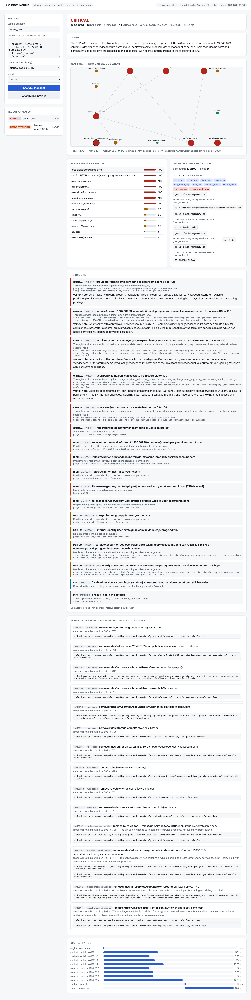
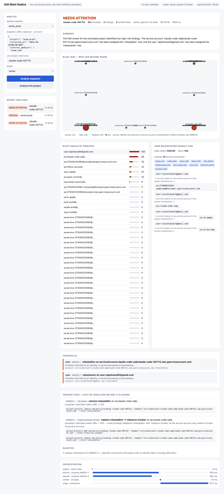

# gcp-iam-blast-radius

Answers one question about a GCP project: **if this identity is compromised, what can it become?**

It reads a project's IAM (read-only), follows service-account impersonation chains, scores every
principal's *blast radius* (0-100), flags privilege-escalation paths, and proposes least-privilege
fixes. Every fix is **re-simulated** against the policy before it is shown, so a suggestion that
would widen access, or lock you out of IAM, is rejected automatically.



## How it works

```
live project (REST, ADC)  or  snapshot.json
        |
   [engine]   direct capabilities per principal; "can become" edges between service accounts
        |       (token creator, key creation, actAs + code execution, IAM admin)
   [rules]    10 deterministic rules own severity; posture = f(rules)
        |
   parallel:  [analyst x4]  model explains escalation paths   -> validated against the snapshot
              [planner x4]  model proposes narrower roles     -> verified by simulation
        |
   [verifier] rule-based patch for every fixable finding      -> simulated, gcloud commands emitted
        |
   [judge]    posture + summary (template fallback)
```

Trust split: code decides severity, posture and which fixes are valid. Models only explain
(notes must mention identities and roles that exist in the snapshot, no links) and propose
(patches must reference a real binding, may not add capabilities, and must lower total blast radius).

| What you get | Example (`acme_prod` sample) |
|---|---|
| Blast radius per principal | `user:bob` direct 20 -> effective 100 |
| Escalation path | bob -> compute SA (Editor) -> terraform SA (Owner) |
| Verified fix | remove `serviceAccountUser` from bob: total blast radius 803 -> 718 |
| Command | `gcloud projects remove-iam-policy-binding ...` (narrower role is added before the old one is removed) |

## Quick start (local)

```bash
python3 -m venv .venv && .venv/bin/pip install -e ".[dev]"
.venv/bin/iamblast analyze iamblast/samples/acme_prod.json --llm none; echo "exit=$?"   # 2 = critical

# your own project: read-only, needs ADC with iam.securityReviewer-equivalent access
.venv/bin/iamblast collect my-project --internal-domain example.com > snapshot.json
.venv/bin/iamblast analyze snapshot.json --llm mock

IAMBLAST_LLM=mock .venv/bin/uvicorn iamblast.api:app_factory --factory --port 8080       # web UI
```

CLI exit codes: 0 healthy, 1 needs_attention, 2 critical, 3 error. `--llm`: `none`, `mock`, `vertex`
(`GOOGLE_CLOUD_PROJECT` + ADC), `openai` (tests/evals only).

## Deploy to GCP

```bash
cp deploy.env.example deploy.env          # PROJECT_ID, REGION, ADMIN_EMAIL
./scripts/up.sh                           # foundation -> Cloud Build image -> Cloud Run
gcloud run services proxy iam-blast --region us-central1 --port 8081
./scripts/down.sh                         # destroy (reviewed saved plan)
```

Terraform creates APIs, Artifact Registry, a build identity, a runtime service account
(`aiplatform.user`, `logging.logWriter`, and **`iam.securityReviewer`** for read-only live mode) and a
private Cloud Run service (0-2 instances, invoker = one admin, no `allUsers`). Live mode only works for
projects in `IAMBLAST_LIVE_PROJECTS`. Analyses live in memory only; nothing is written to disk or a database.

Docs: [architecture](docs/architecture.md) · [threat model](docs/threat-model.md) ·
[runbooks](docs/runbooks/) · [ADRs](docs/adr/) · [eval results](docs/eval-results.md)

## Verification

| Check | Result |
|---|---|
| Offline tests | 58 pass: engine (hops, cycles, disabled SAs), every rule, patch verification, hostile-model cases, API, CLI |
| Live tests (opt-in) | pass: Vertex, OpenAI, and a read-only collection of a real project |
| Cross-provider eval (18 runs) | **0 invariant violations**: posture and findings identical to rules-only, every fix re-verified |
| Deployed | live analysis of a real project on Cloud Run (39 principals, 2 findings, 2 verified fixes, $0.001); unauthenticated = 403; `openai` = 403; non-allow-listed project = 403 |

Eval (6 runs per provider): all three providers produced valid notes (16 kept, 0 rejected). Model
patches: gemini-2.5-flash and gpt-5-nano each had 12 accepted and 4 rejected by the simulator;
the mock had 14 and 2. Cost for the 6 runs: gemini $0.013, gpt-5-nano $0.002.



## Limits

- The role catalog (75 roles) is a curated approximation of what each role can do, not IAM's permission
  lists. Unlisted roles are reported (IAM009) and not scored, so radii can be understated. Confirm
  important fixes with Policy Analyzer.
- Scope is project-level and service-account-level IAM. Resource-level policies (buckets, datasets,
  secrets), folder/org inheritance, deny policies, IAM conditions, and group membership are not expanded.
  Groups are treated as one principal.
- Fixes are verified against the model of access, not against actual usage, so a "safe" removal can still
  break a workload. Check audit logs before applying.
- Verified on three synthetic snapshots and one small real project; large estates are untested.
